 

  

---

## About me

- **Currently building:** <!--BUILDING:START-->[**ML-**](https://github.com/Tejaszz-epsilon/ML-) - This is my jupyter notebook projects that I had done during my preparation in Andrew NG's ML course.<!--BUILDING:END-->
- **Learning:** Agentic AI, Machine Learning
- **Ask me about:** AI!
- **Reach me:** [LinkedIn](https://www.linkedin.com/in/tejas-amarnath-6b00bb2a7/)

## Tech stack

## GitHub stats

## Contribution activity

## The snake

---

